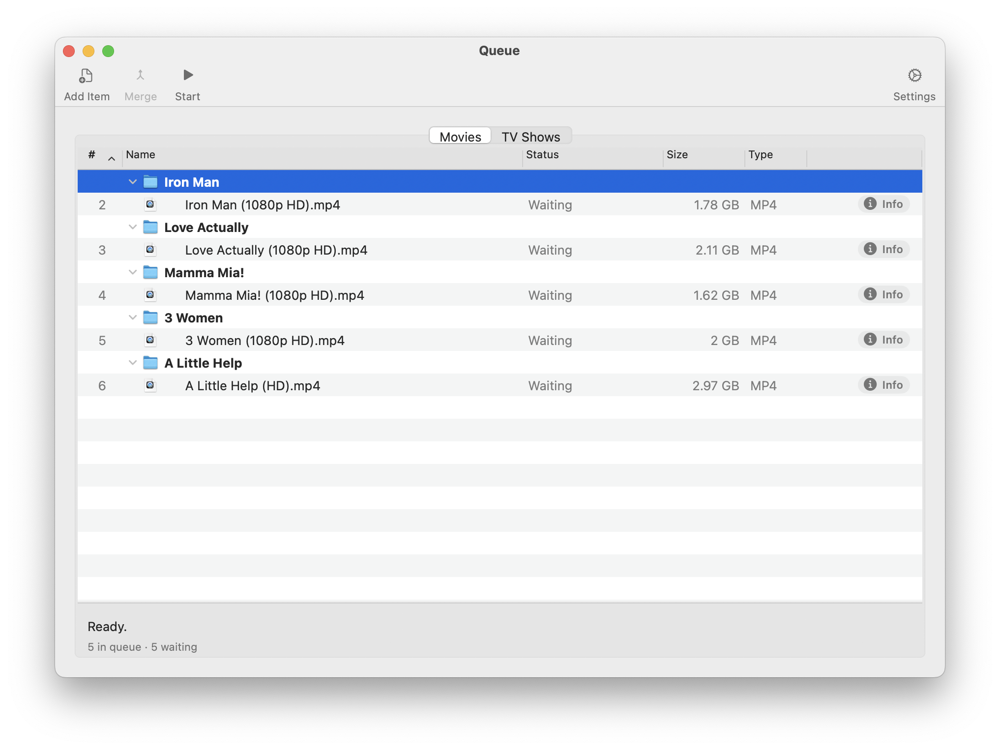
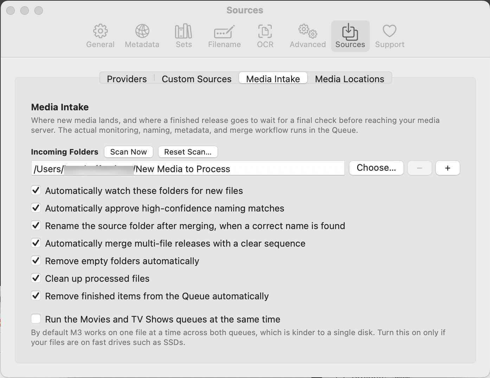
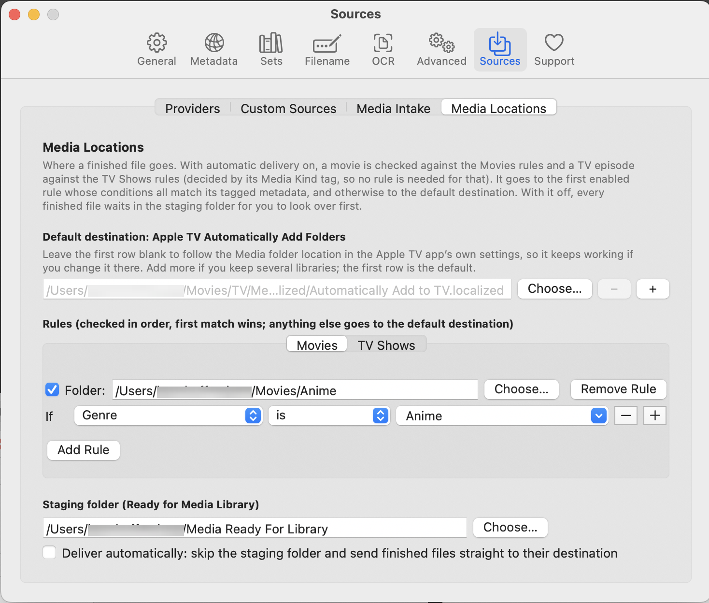
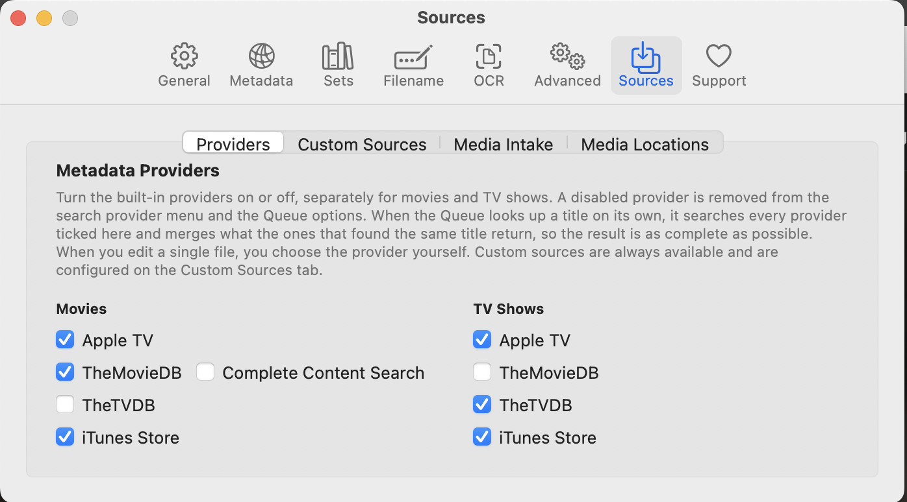
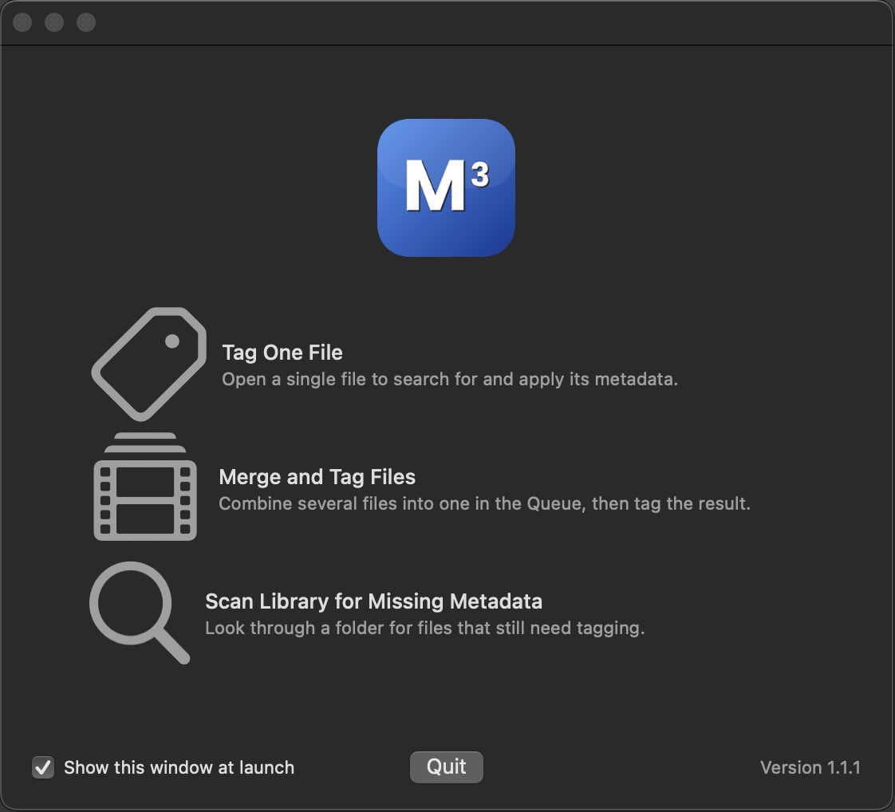
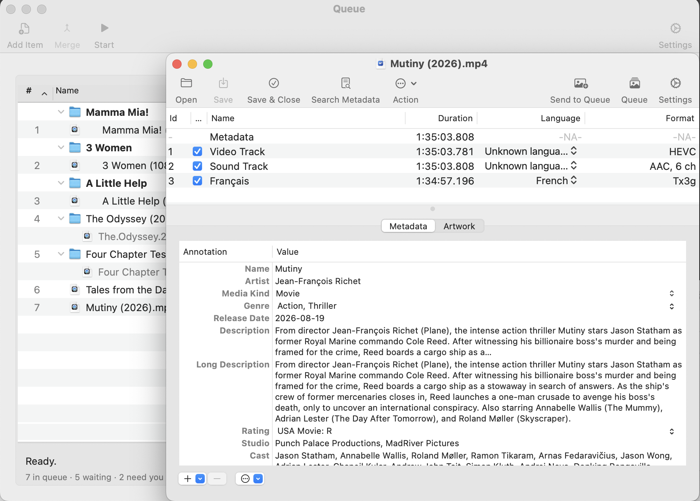
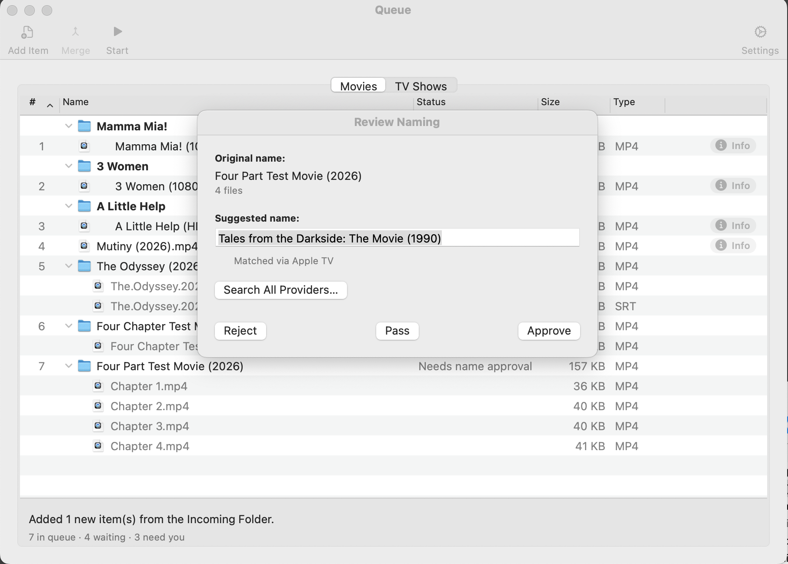
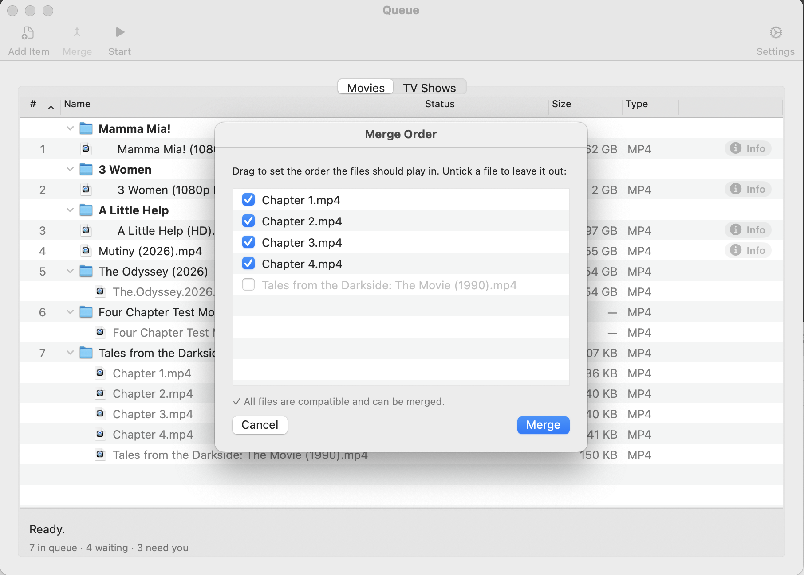

# Welcome

Media Metadata Manager (M3) tags, names, merges and organizes your video files so they are ready for your media library. It is a fork of the open-source Subler app, extended with more metadata sources, lossless file merging, a library scanner and an automated *Intake* workflow that takes a finished download all the way to a tidy, correctly named, fully tagged file.

This guide gets you from a fresh install to your first finished file in about ten minutes. For every setting and screen in detail, see the **User Guide**.

**What you need**

- A Mac running macOS 10.13 or later (macOS 11 or later is recommended; a few interface details use newer system features).
- A folder where your downloads arrive (the *Incoming Folder*) and a folder where finished files should land (*Ready for Media Library*).
- An internet connection for metadata and artwork lookups.

# The 60-second tour

M3 has four places you will use:

<!-- screen:queue-movies-tab.png:Getting-Started -->

| Window | What it is for |
|---|---|
| **Queue: Movies tab** | The home of your work. Every file or folder waiting for naming, tagging or merging is one row. |
| **Queue: TV Shows tab** | The same list on its own tab, kept separate so TV episodes do not mix with movies. |
| **Editor** | Opens one file so you can search for metadata, edit tags, change artwork and save. |
| **Preferences** | Where you choose metadata sources, naming rules and the Media Intake options. |

Work flows in one direction: **Incoming Folder → Queue → (review where needed) → Ready for Media Library.** Nothing is moved into your final library without passing through the folder you chose.

# Set up once (3 minutes)

1. Choose **Media Metadata Manager → Preferences…** and open the **Sources** tab, then the **Media Intake** sub-tab.
2. Under **Incoming Folders**, click **+** and choose the folder where your downloads finish. You can add several.
3. Open the **Media Locations** sub-tab and, under **Staging folder (Ready for Media Library)**, click **Choose…** and pick the folder where finished files should wait for you to check them. Leave **Deliver automatically** off until you trust the results. (Later you can add rules there to send, for example, documentaries or a rating to a different folder, and turn automatic delivery on; movies and TV shows have separate rules, and the default destination is the Apple TV Automatically Add folder, followed from the Apple TV app's own settings.)
4. Leave the other options at their defaults for now. Every option is off or conservative by default, so nothing happens behind your back.
5. Still in Preferences, open **Sources → Providers** and make sure the metadata providers you want are ticked for **Movies** and **TV Shows**.

<!-- screen:prefs-media-intake.png:Getting-Started -->

<!-- screen:prefs-media-locations.png:Getting-Started -->

<!-- screen:prefs-providers.png:Getting-Started -->

> **Tip:** Hover over any option in the Media Intake tab for a plain-language explanation of what it does.

# Your first file, the quick way (single file)

Use this when you just want to tag one file.

1. On the Welcome window choose **Tag One File**, or use **File → Open…** and pick a video.
2. In the editor, click **Search Metadata** in the toolbar. **Do not skip this step** — a file saved with no title tagged keeps its original name.
3. Pick the best match from the results. Title, description, cast and artwork appear on the right.
4. Click **Save**, or **Save & Close** to finish in one click.

<!-- screen:welcome-window.png:Getting-Started -->

<!-- screen:editor-window.png:Getting-Started -->

**Good to know:** the file is changed in place and then moved into your Ready for Media Library folder. M3 does not keep the original and nothing goes to the Trash. If you may want the old version back, copy the file first.

# Your first batch, the Intake way

Use this for a folder of downloads.

1. Drop a finished download into your Incoming Folder. (To skip waiting, click **Scan Now** in Preferences → Sources → Media Intake.)
2. Open **Window → Show Movies Queue**. The download appears as a row marked as waiting for naming. TV episodes are sent to the **TV Shows Queue** automatically.
3. **Double-click the row.** The *Naming Review* sheet shows a suggested name in the form `Title Vol N [Studio] (Year)`. Edit it if needed and click **Approve**.
4. What happens next depends on the files in the folder:
   - **One file:** M3 checks the online match. If it is confident, the row is ready at once. If not, double-click the row again for the *Metadata Review* sheet, confirm the match and choose Portrait or Landscape artwork.
   - **Several parts of one movie:** double-click the row to open the *Merge Review* sheet, drag the parts into play order and confirm. M3 joins them without re-encoding and adds a chapter at each join.
5. Click **Start** in the Queue toolbar. M3 writes the file, fetches metadata and artwork, tags it, and moves the folder into **Ready for Media Library**.
6. Open the Ready folder and check the result. That is your final checkpoint before the file goes to Plex, Jellyfin, Apple TV or wherever your library lives.

<!-- screen:naming-review-sheet.png:Getting-Started -->

<!-- screen:merge-review-sheet.png:Getting-Started -->

# Turn on the time-savers (optional)

When you trust the results, these options in **Sources → Media Intake** remove clicks:

| Option | What it saves you |
|---|---|
| Automatically watch these folders for new files | New downloads appear in the Queue by themselves. |
| Automatically approve high-confidence naming matches | Skips the Naming Review sheet when the online title matches the file name exactly. |
| Automatically merge multi-file releases with a clear sequence | Skips the Merge Review sheet when parts are numbered and compatible. |
| Remove empty folders automatically | Tidies folders left behind. Items go to the Trash. |
| Clean up processed files | Moves the original parts to the Trash after a Queue merge or conversion. Off by default so your originals stay as a backup. Does not apply to files saved from the editor. |

# If something looks wrong

| You see | Try this |
|---|---|
| A download never appears in the Queue | Click **Scan Now**. Check the folder is listed under Incoming Folders and that the download has finished (files ending in `.part` or `.crdownload` are skipped). |
| A row says **Rejected** | You rejected its name. Double-click the row to review it again. |
| A merge failed | The row shows the reason in plain language, for example parts with different video formats. Reopen the row to change the selection. |
| The match is wrong | In the Metadata Review sheet or the editor, search again or choose another result. **Search All Providers…** in the Naming Review sheet shows one result from every enabled source. |
| You deleted something by mistake | Items removed by the Queue's cleanup options go to the macOS Trash and are listed in log files in `~/Library/Application Support/M3/`. A single file saved from the editor is changed in place and moved to Ready, with no original kept, so restore it from your own backup. |

# Where to go next

- **User Guide** — every window, menu, toolbar button and preference, with step-by-step tasks.
- **Window → Show Message Log** — a running log that is useful when reporting a problem.
- Project home and issue tracker: github.com/MediaMetadataManager/MediaMetadataManager

*Media Metadata Manager is based on Subler by Damiano Galassi and contributors and on MP42Foundation. See CREDITS.md for full attribution.*
