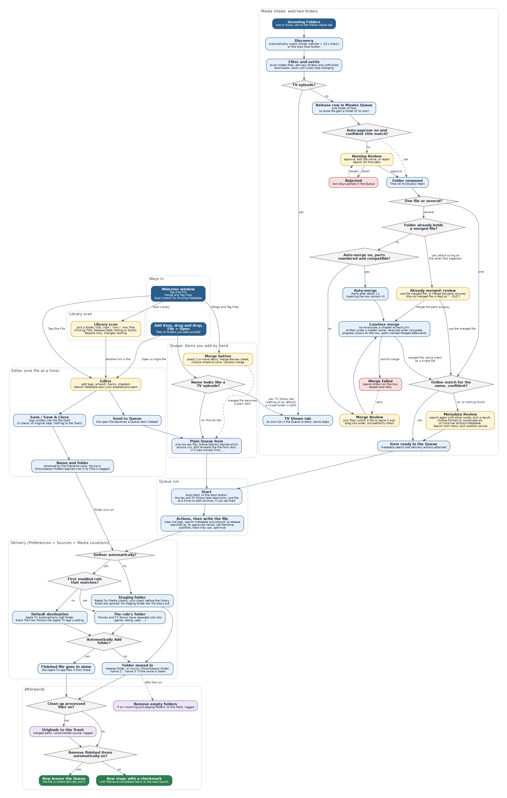

# About this guide

This guide describes every window, menu and setting of Media Metadata Manager (M3) and walks through the common tasks. If you only want to get going, read the **Getting Started Guide** first and come back here for detail.

**Conventions.** Menu paths are written *Menu → Item*. Buttons and settings are shown in **bold**. File and folder names are shown in `code style`. Notes marked *Tip* are optional shortcuts; notes marked *Important* describe behavior that can affect your files.

**Scope.** M3 is a personal fork of the open-source Subler app. Everything Subler does — muxing and tagging MP4, M4V and MOV files, importing tracks from MKV and raw formats, chapters, subtitles, OCR of image subtitles — still works. This guide concentrates on what M3 adds: extra metadata sources, the Queue-based Intake workflow, lossless merging, naming rules, library scanning and the cleanup options.

# 1. Concepts in one page

**Incoming Folder.** A folder where downloads arrive. M3 can watch one or several of them.

**Ready for Media Library.** The staging folder where finished files and folders are placed. It is your last human checkpoint before the files reach a media server. M3 never writes into your final library itself.

**Queue.** An ordered list of jobs. There are two lists, the **Movies Queue** and the **TV Shows Queue**, shown as two tabs of one Queue window. Jobs run in the order shown, one at a time. By default the two lists take turns (see 5.1).

**Row.** One line in a Queue. A row is either a plain **item** (a single file you added by hand) or a **release** (a folder of files discovered by Intake that still needs naming, a metadata decision, or a merge).

**Release.** A folder that holds one title, either as one file or as several parts. A release moves through stages: waiting for naming, waiting for a metadata decision or merge order, merging, ready, done. A release stays the same row for its whole life.

**Review sheet.** A small panel that slides out of the Queue window when M3 needs a decision from you: *Naming Review*, *Metadata Review* or *Merge Review*. You open one by double-clicking a row or choosing **Edit**.

**Provider.** An online source of metadata and artwork, such as TheMovieDB, TheTVDB, Apple TV or the iTunes Store. **Custom sources** are providers you define yourself from a web API. **Plugins** are compiled providers added as bundles.

**Set.** A saved group of metadata fields that you can apply to a file in one step, for example a fixed rating or content advisory.

**Naming rule.** A template that builds a file name from the file's tagged metadata, for example `Title [Studio] (Year)`. Rules can be conditional.

# 2. Installing and starting M3

**What you need.** A Mac running macOS 10.13 or later (macOS 11 or later is recommended; a few interface details use newer system features) and an internet connection for metadata and artwork lookups.

## 2.1 Installing

1. Download the latest zip from the **Releases** page of the project on GitHub (github.com/MediaMetadataManager/MediaMetadataManager).
2. Unzip it and drag **M3** into your **Applications** folder.
3. The first time you open it, macOS may say it cannot verify the app. Open **System Settings → Privacy & Security**, scroll to the message about M3, click **Open Anyway**, and confirm. On older versions of macOS, right-click the app and choose **Open** instead. You only need to do this once.

You can also build M3 from source in Xcode; the project README has the instructions. The built app is the same normal Mac application.

## 2.2 Updating

Choose **Media Metadata Manager → Check for Updates…** to look for a newer version. M3 also checks for updates by itself about once a day and offers any it finds, with a short list of what changed. Accept the update and M3 downloads it, replaces itself and restarts.

M3 never takes updates from the original Subler; it uses this project's own update feed only. Updating replaces the application only: your preferences, folders, keys and installed plugins stay where they are, so you do not need to set anything up again. To see which version you are running, open **Media Metadata Manager → About**.

## 2.3 First launch

On first launch you will see the **Welcome window** with three actions:

- **Tag One File** — open a single file to search for and apply its metadata.
- **Merge and Tag Files** — combine several files into one in the Queue, then tag the result.
- **Scan Library for Missing Metadata** — look through a folder for files that still need tagging.

Untick **Show this window at launch** to stop seeing it. You can choose what M3 does at launch under **Preferences → General → At Launch**: show the open panel, show the main window, or show the Queue.

# 3. The windows

## 3.1 The Editor (single-file window)

Opening a file with **File → Open…**, from the Welcome window, or by double-clicking a Queue row's **Edit** button shows the editor. It lists the file's tracks, its chapters and its tags, and lets you change any of them.

**Toolbar.** The default toolbar contains:

| Button | Action |
|---|---|
| **Open** | Open another file. |
| **Save** | Write your changes to the file. |
| **Save & Close** | Save and close the window in one step. |
| **Search Metadata** | Search the enabled providers and apply a result. |
| **Send to Queue** | Add the open document to the Queue instead of saving directly. |
| **Queue** | Show the Queue window. |
| **Import / Delete / Action** | Add a track from another file, remove the selected track, and a menu of track tasks (insert chapters at a fixed interval, organize alternate groups, clear or prettify track names, fix audio fallbacks, offset). |
| **Settings** | Open Preferences. |

You can change which buttons are shown, and whether they show icons, text or both, with **View → Customize Toolbar…** or by right-clicking the toolbar. *Tip:* if you customized the toolbar before an update, new buttons such as **Save & Close** appear in the Customize Toolbar sheet and can be dragged in.

**Undo and redo.** Every edit — tags, artwork, tracks, chapters — can be undone and redone with **Edit → Undo / Redo**. The window's edited dot clears when you undo everything or save.

### Searching for metadata

1. Click **Search Metadata**. The title field is pre-filled from the file name, with release codes and quality tags removed.
2. Results appear in a list. Select one to see its full metadata and artwork on the right. The first result is selected for you.
3. Choose the artwork you want. **Select All** adds every available image; **Load more artwork…** fetches additional images.
4. Click **Add**. Fields that changed are highlighted in the editor, with a tooltip, until you edit them by hand.

*Important.* If you save a movie that has no title tagged, M3 leaves its file name and folder alone. Run a metadata search first if you want the file renamed from its tags.

## 3.2 The Queue windows

Choose **Window → Show Movies Queue** or **Window → Show TV Shows Queue**, or click **Queue** in the editor's toolbar. They all open the same Queue window, which has a **Movies** tab and a **TV Shows** tab; the menu item you chose decides which tab is showing. Each tab keeps its own list, the toolbar acts on the tab that is showing, and the window remembers its position and the last tab you used across launches. A TV show added by Intake opens its tab automatically. The Dock badge shows the combined number of waiting items.

**Toolbar.** The default order, from the left, is **Add Item**, **Merge**, **Start / Stop**, flexible space, **Settings**.

| Button | Action |
|---|---|
| **Add Item** | Add files or folders to the Queue by hand. Files added this way become plain items. Files whose names look like TV episodes are put on the TV Shows tab (see **Handle TV episodes** in section 6). |
| **Merge** | Enabled when two or more not-yet-processed items are selected. Opens the Merge Review sheet, then asks where to save the merged file. |
| **Start / Stop** | Run or pause the Queue. |
| **Settings** | Show or hide the Queue Options panel (see 3.3). |

The toolbar's display mode (icon, icon and text, or text only) also controls the **Info** and **Edit** buttons on each row and the progress display at the bottom of the window: with text shown, a percentage; with icons only, a progress bar.

**Columns.** Each tab lists **Name**, **Status**, **Size** and **Type**. Click a column header to sort by it (A to Z, with numbers in names sorted as numbers) and click again to reverse. Sorting changes the order the files are processed in, can be undone with **Edit → Undo**, and rows can still be dragged. Files added from a folder stay under their folder.

**Folders.** A folder that is still waiting to be named or merged has a disclosure triangle. Click it, or press the Right and Left arrow keys on the selected folder, to list the files inside; Option-click opens or closes every folder at once. The listed files are for looking at only. While a folder is being merged, each of its files shows *Merging* in the Status column with a percentage, and the progress bar and status line at the bottom follow the merge.

**Rows.** Each row shows a status icon and the name. On the right are two buttons:

- **Info** shows the item's source, destination and the actions that will run.
- **Edit** opens the editor for that file, or the right review sheet for a release that is waiting for you.

Closing an editor window does not remove its row.

**Row states for a release.**

| State | Meaning | What to do |
|---|---|---|
| Waiting for naming | The folder was found; its name is not yet approved. | Double-click to open Naming Review. |
| Naming rejected | You rejected the suggested name. The row stays so nothing is lost. | Double-click to review again. |
| Waiting for metadata review | One file (or a merged file); the online match was not confident enough, or nothing was found. | Double-click to open Metadata Review. |
| Waiting for merge order | Several files; the order is not yet confirmed. | Double-click to open Merge Review. |
| Already merged: review | The folder already holds a merged file (one about as big as all the other files together), so M3 did not merge the parts again. | Double-click to use the merged file, or to merge the parts anyway (the existing merged file is kept and renamed with " - OLD" added). |
| Merging | The parts are being joined. | Wait; progress is shown on the row. |
| Merged | The parts of this folder have been merged; each part file shows *Merged* in the Status column. | Nothing; carry on with the merged file. |
| Merge failed | The parts could not be joined. The reason is shown in plain language. | Double-click, adjust the selection, retry. |
| Ready | A single file is ready to be written. | Click **Start**. |
| Done | The release has been delivered: to the staging folder, or with automatic delivery on, to its final destination. | Remove it with **Remove completed items**, or turn on **Remove finished items from the Queue automatically**. |

**Context menu.** Right-click a row for **Reveal in Finder**, **Edit…**, **Remove from queue** and **Remove completed items**. You can also drag rows to change their order, and drop files or folders from Finder into the window. A dropped folder is grouped under its own folder row, exactly as with the **Add** button; a dropped file is added as a single row. TV episodes dropped on the Movies tab are moved to the TV Shows tab in the same way as with **Add**.

## 3.3 Queue Options

The **Settings** button reveals the options applied to items you add by hand and to released items as they are processed:

- **Global options:** *Auto-Start the queue*; *Show Notification When Done* (macOS asks permission the first time).
- **Location** and **File Type** (`mp4` or `m4v`) for the output.
- **Apply Set** (applied after the online search, for hand-added files and Intake releases alike: the tags the Set fills in replace the searched values, and tags it leaves blank keep them), **Fetch Metadata** and the provider language for Movies and TV Shows, **Artwork** shape (Portrait, Landscape, Square or Rectangle), and **Set output filename**.
- **Track tidy-ups:** *Clear existing metadata*, *Rename chapter titles*, *Organize groups*, *Prettify audio track names*, *Fix audio fallbacks*, *Clear track names*, *Load external subtitles*, *Complete tracks language*, *Enable audio / subtitle track with language*.
- **Optimize** and the **color space** options. Where a finished file goes is decided by the Media Locations tab (see 5.5), not by the Queue options.

## 3.4 Review sheets

**Naming Review.** Shows the original folder name, how many files it holds, and an editable suggested name. A local guess appears immediately; a background search of your enabled providers refines it unless you have started typing. Buttons:

- **Approve** renames the folder to the approved name.
- **Reject** parks the row without touching any file.
- **Search All Providers…** runs a second pass that shows one result from every enabled provider, so you can pick the correct one.

If **Automatically approve high-confidence naming matches** is on and the online title matches the file name exactly (and the years agree when both are known), the sheet approves itself after about a second. Typing in the field or clicking a button cancels that.

**Metadata Review.** Appears for a single-file release whose automatic match was not confident, or when the online search found nothing at all. It shows the match found and an artwork preview, with a **Portrait / Landscape** control that applies only to this release. If the match is wrong or missing, change the words in **Search for** and press **Search** (or Return), then pick the right entry from the list of results. **Use This Match** applies the entry you picked. If nothing can be found, **Continue Without Metadata** delivers the file as it is.

**Merge Review.** Lists the parts. Drag them into play order. The sheet starts in the order implied by the files' own numbers (`01`, `02`, `Part 1`, `e1`…). Confirming starts the merge.

## 3.5 Library scan window

Choose **Scan Library for Missing Metadata** on the Welcome window. Pick a folder and click **Scan**. M3 walks the folder for finished `.mp4`, `.m4v` and `.mov` files and lists those missing a Title, Release Date, Rating or Studio. Double-click a file to open it in the editor. The scan only reports; it never changes a file.

The scan reads only each file's tags, not its tracks or chapters, so it is light on the drive, and the status line names the file it is reading. The **gear button** next to Scan shows the four tags that are always checked and a list of every other tag from Metadata; tick any of them to have the scan look for those too. Your choice is remembered. A file that cannot be read within 20 seconds is listed as *Unreadable (timed out)* and the scan carries on; if three files in a row cannot be read, the scan stops and tells you to check the drive. Slow reads are written to the message log.

## 3.6 Message log

**Window → Show Message Log** shows what M3 has been doing. It is the first place to look, and the thing to attach, when reporting a problem.

# 4. Preferences

Open **Media Metadata Manager → Preferences…** (or the **Settings** toolbar button). Tabs:

## General

At-launch behavior, whether the window remembers its size, the default artwork position (Portrait or Landscape), chapter preview image position, log format, the ratings region to show (USA ratings are always shown), and privacy actions: *Clear recent searches* and *Delete cached metadata*.

## Metadata

Choose which tags are shown for Movies and TV Shows and in what order. **Fill Series Description for sequels/parts** copies the series description when a title ends in a number or in "Part…".

## Sets

Create and edit Sets: saved groups of settings you can reuse. Metadata sets hold tag values (genre, studio, rating and so on) that can be applied to a file with one click; Queue sets hold a group of Queue options. Choose a set in the Queue options and it is applied to every item automatically, so sets can be a step in a workflow: add files and each one is tagged the same way as it is processed.

## Filename

Naming rules decide the output file name. There is a rule list for **Movies** and one for **TV Shows**. Each rule is a template built from tokens (title, studio, year and so on) with optional conditions (**If / And / Or** a field has a value). The first matching rule wins; the **Default** rule is used when none matches. A rule can be switched off with its checkbox. Two extra options live here:

- **Keep the containing folder named to match** — after saving, rename a folder that holds only this one movie to the same name as the file.
- **Organize into Show/Season folders (Apple TV style)** — create `Show/Season NN` folders for TV episodes.

A movie with no title tagged is never renamed, whatever the rules say.

## OCR

Download or remove the language data used to convert image-based subtitles to text.

## Advanced

Audio conversion choices (AC-3, DTS, downmix, dynamic range control, bitrate), *Force QuickTime Compatibility*, *Infer media characteristics*, alternate-group organization and HEVC options.

## Sources

Four sub-tabs:

- **Providers** — tick the built-in providers you want for Movies and for TV Shows. Installed plugins appear in the same list, each with a **Configure…** button where the plugin needs settings. **Complete Content Search** asks TheMovieDB to include its complete result set.
- **Custom Sources** — define your own providers (see section 7).
- **Media Intake** — the Intake workflow settings (see section 5).
- **Media Locations** — where finished files are delivered: the Apple TV Automatically Add folder as the default, rules by metadata, and the staging folder (see 5.5).

## Support

Links to sponsor Media Metadata Manager through GitHub Sponsors and to the original Subler project, whose author Damiano Galassi created the app M3 is built on. The same two links are in a small dialog under **Media Metadata Manager → Support…**. Nothing pops up on its own, and the buttons only open a web page in your browser.

# 5. Media Intake in detail

## 5.1 Settings reference

All of these are in **Preferences → Sources → Media Intake**. Hover over any option to see its tooltip.

| Setting | Default | What it does |
|---|---|---|
| **Incoming Folders** (+ / −, **Choose…**) | none | The folders M3 looks in. Loose files are wrapped in a folder of their own; folders holding media (up to three levels down) become releases. |
| **Scan Now** | — | Looks in the Incoming Folders immediately and adds what it finds, even when watching is off, without waiting for files to settle. TV episodes go to the TV Shows Queue. |
| **Reset Scan…** | — | Forgets which files the scan has already taken in, then scans again. Use it when something sitting in an Incoming Folder is not being picked up, for example after you removed its row from the Queue. Anything already in a Queue is not duplicated. |
| **Automatically watch these folders for new files** | off | Watches the folders and also re-checks every 20 seconds. A new item is added once its files have stopped changing for about 10 seconds. |
| **Automatically approve high-confidence naming matches** | off | Approves the suggested name without a click when the online title matches exactly. |
| **Rename the source folder after merging, when a correct name is found** | off | After a manual Queue merge, renames the download folder to a correct release name found nearby (a cover image, the folder name, or a well-named video). Never overwrites an existing folder. |
| **Automatically merge multi-file releases with a clear sequence** | off | When every part carries a sequence number and the parts are compatible, merges after about a second instead of stopping at Merge Review. Opening the row in that second cancels it. |
| **Remove empty folders automatically** | off | After each Queue run and each editor save, moves empty folders inside the Incoming and Ready folders to the Trash and logs them. Folders touched in the last two minutes are left alone. The same cleanup can be run by hand with **Window → Clean Up Empty Folders…**. |
| **Clean up processed files** | off | After a release is moved into Ready for Media Library, moves the original files it was made from (the parts that were merged, or the unconverted source when the Queue converted a file) to the Trash and logs them. The finished file is never touched. This applies to Queue runs only; it does not apply to a file you tag with Edit and Save (see 5.4). |
| **Remove finished items from the Queue automatically** | off | When a Queue run finishes, the rows with a checkmark are taken off the list. Only the rows are removed, never files. Failed rows and rows still waiting for you stay. |
| **Send TV episodes to the TV Shows tab when I add files** | on | When you add files by hand (Add button, drag and drop, File → Open) to the Movies tab, any whose names look like TV episodes are put on the TV Shows tab instead, and the status line at the bottom of the Queue says so. Movies added to the TV Shows tab are left where they are. Turn it off to keep every hand-added file on the tab you chose. Files found in the Incoming Folders are always sorted this way, whatever this setting says. |
| **Run the Movies and TV Shows queues at the same time** | off | Off: the two queues take turns, one file at a time, which is kinder to a single disk. On: each queue works by itself, so two files can be processed at once. Turn it on only if your files are on fast drives such as SSDs. |
| **Ready for Media Library** | none | Now set on the **Media Locations** tab (see 5.5), where it is the **staging folder**: finished files wait there for you to check them. |
| **Automatically Add to Apple TV Folders** | | Now on the **Media Locations** tab (see 5.5), where it is the default destination. |

## 5.2 What happens, step by step

1. **Discovery.** M3 finds media files in the Incoming Folders. It ignores hidden files, packages, symbolic links, the Ready folder, and folders that still contain unfinished downloads (`.part`, `.crdownload` and similar). Anything it has already taken in, or that is already in a Queue, is skipped. A path is forgotten once the file is gone, so putting a file with the same name back later is treated as new.
2. **TV or movie.** A name with a season and episode marker (for example `S02E05` or `2x05`) goes to the **TV Shows Queue**; everything else goes to the **Movies Queue**.
3. **Naming.** M3 proposes `Title Vol N [Studio] (Year)`. It understands uploader-stamped names such as `2026_Uploader_Title_Studio_720p` and `03.10.2026_Uploader_Title_Studio_720p`, and scene names such as `Title.2023.1080p.WEB-DL.x264-GROUP`. You approve, edit or reject, or it is approved automatically when you have chosen that option.
4. **Metadata or merge.** One file: the online match is checked. Several files: the parts are checked for compatibility and ordered, merged, and then the merged file gets the same online match check as a single file. The merged file appears under its final name only when it is complete (a merge of a long movie can take ten minutes or more).
5. **Ready.** The release becomes a normal Queue item with a metadata step and a move-to-library step attached.
6. **Start.** The Queue writes the file, searches the provider you chose, applies artwork and tags, and then moves the whole release folder into **Ready for Media Library**. If a folder with that name already exists there, the new one is called `name 2`, `name 3` and so on; nothing is overwritten.
7. **Cleanup** (if enabled), then your final check in the Ready folder.

## 5.3 Lossless merge

Joining parts does not re-encode anything. M3 splices the compressed video and audio samples one after another and adds a chapter at each join, named after the source file.

Parts are merged only when they match: the same number of video, audio and subtitle tracks, the same codecs and time scales, and the same picture size. If they do not match, the merge is refused and the row explains which file differs and how. Nothing is partly merged. Incompatible parts need to be converted first.

You can also merge by hand: select two or more items in the Queue and click **Merge**, or choose several files in **File → Open…** and answer **Merge Into One File…**. The merged file is written next to the parts by default.

## 5.4 Safety guarantees

- Intake only moves files and folders; it never deletes. Removal happens only through the two cleanup options, and only to the **Trash**.
- **Tagging a single file with Edit and Save works in place.** The tags are written into the file itself, the file may be renamed, and its folder is moved into **Ready for Media Library**. M3 does not keep a copy of the original and nothing is sent to the Trash, so the previous tags cannot be restored afterwards. If you want a backup, copy the file before you save. (Queue merges keep their parts unless you turn on **Clean up processed files**.)
- Cleanup actions are written to `Removed Empty Folders.txt` and `Cleaned Up Processed Files.txt` in `~/Library/Application Support/M3/`.
- A failed move (disk full, drive disconnected) cleans up after itself and offers another location.
- Parts are kept after a merge unless you turn on **Clean up processed files**, so you can check the result before the originals are gone.

## 5.5 Media Locations: where finished files go

**Preferences → Sources → Media Locations** decides where a finished file ends up. It has three parts.

**Default destination: Apple TV Automatically Add Folders.** The folder the Apple TV app watches and organizes itself. Leave the first row blank and M3 follows the **Media folder location** in the Apple TV app's own settings (Settings → Files), read each time it is needed, so a library you move later is picked up without any change here; the folder it currently resolves to is shown greyed out in the first row. Type or choose a folder in the first row to override it, or add more rows with **+** if you keep several libraries (the first row is the default). If the Apple TV app is not set up, M3 falls back to the Music app's setting and the usual locations. A file delivered straight into one of these folders is left alone instead of being wrapped in a folder of its own, because the app files it from there.

**Rules.** The **Movies** and **TV Shows** tabs each have an ordered list of rules for sending files somewhere other than the default.

Which list a file is checked against is decided by its **Media Kind** tag: a TV Show goes through the TV Shows rules and everything else, including a file with no Media Kind, through the Movies rules. You never need a rule that says Movie goes to Movies or TV Show goes to TV Shows; rules are only for choosing a different folder within a kind. In a rule, the Media Kind value list offers the same names as the Metadata tab (Movie, TV Show and so on).

- A **rule** has a checkbox (to turn it on or off), a **Folder**, and one or more conditions in the form *If Genre is Documentary*. Conditions use the same fields and wording as the Filename rules: conditions on different fields must all match (And), conditions on the same field match if any one does (Or).
- Rules are checked from the top. The **first enabled rule that matches** the file's tagged metadata decides the folder. If none matches, the default destination is used.
- **Add Rule** adds a rule at the end of the list; **Remove Rule** deletes it. A rule with no folder is ignored.
- For the **Rating** field the value list follows **Preferences → General → Show ratings for** (the chosen country plus the USA, or every country when set to All countries), limited to ratings that apply to movies or TV as appropriate; pick a value from the list so it matches exactly. Rules look at the metadata the file has when it is delivered, so a file with no genre tagged will not match a genre rule.

**Staging folder (Ready for Media Library).** Where finished files wait for you to look them over before they reach your library, and the setting that decides whether the rules are used at all.

- **Deliver automatically** is **off** by default. While it is off, every finished file goes to the staging folder, whatever the rules say, and you move it on yourself. This is the way to work while you are building trust in the system.
- Turn it **on** and finished files skip staging: they go from the watched folder straight to the first matching rule's folder, or to the default destination. Folders that are Automatically Add folders receive the finished file alone; the originals stay behind (and go to the Trash if **Clean up processed files** is on).
- A new install creates the staging folder for you: **Ready for Media Library** inside your Movies folder. Change it here at any time; a folder you chose is never replaced, and one you clear is not put back.
- Files and folders that are already in the staging folder (or in another delivery destination) can be added to the Queue to be scanned and tagged again. They are updated **in place**: no second copy is made, the file is renamed by your Filename rules, and a movie's folder is renamed to match.
- With it off and no staging folder set, finished files stay where they are.

The same choice applies everywhere a finished file is moved: Queue items, whole releases from Intake, and files saved from the editor.

# 6. Common tasks

**Tag one file.** Welcome window → **Tag One File** → **Search Metadata** → choose a result → **Save & Close**. The file is changed in place and moved to **Ready for Media Library**; no original is kept and nothing goes to the Trash.

**Process a download automatically.** Add the Incoming Folder, tick **Automatically watch**, optionally tick the auto-approve and auto-merge options. New downloads appear in the Queue; open any row that shows a waiting state; click **Start**.

**Merge parts by hand.** Add the parts to the Movies Queue, select them, click **Merge**, drag them into order, confirm, and choose where to save.

**Handle TV episodes.** Episodes found by Intake go to the TV Shows Queue. Turn on **Organize into Show/Season folders** under Preferences → Filename to have them filed as `Show/Season 01/…`. Files you add by hand are sorted the same way: if you drop or add a file whose name has a season and episode marker (such as `S02E05` or `2x05`) on the Movies tab, M3 puts it on the TV Shows tab and says so in the status line. A folder that holds both movies and episodes is split file by file. Movies added to the TV Shows tab stay where you put them, and a name without an episode marker is treated as a movie. If you would rather keep every file on the tab you added it to, untick **Send TV episodes to the TV Shows tab when I add files** under Preferences → Sources → Media Intake.

**Find files that need tagging.** Welcome window → **Scan Library for Missing Metadata**.

**Undo a mistake.** Before you save, use **Edit → Undo** in the editor. After **Save** or **Save & Close** a single file cannot be restored by M3, because it was edited in place; use your own backup. For files moved by the Queue's cleanup options, open the Trash and choose **Put Back**.

**Start over with a stuck download.** Remove its row, make sure the file is in the Incoming Folder, and click **Reset Scan…**.

# 7. Metadata sources

**Built-in providers.** TheMovieDB, TheTVDB, Apple TV and the iTunes Store. Each can be switched on or off separately for movies and TV in Preferences → Sources → Providers. The Queue's automatic lookup searches every enabled provider and merges the results of those that found the same title: the provider chosen in Queue Options is the primary one (its title, date, studio and rating are kept), blanks are filled in from the others, cast, genre and crew lists are combined, the longest description is kept, and artwork from all of them is pooled so the **Artwork** choice in General can be met. A provider that found a different title is ignored. The naming window consults every enabled provider in turn. When you edit a single file you choose the provider yourself.

**Custom Sources.** In Preferences → Sources → Custom Sources, click **+** to define a source from a web API: a base address, a search address, a detail address, and a table that maps the API's fields to M3's tags. Each source opens in its own window. Requests time out rather than hang, and request and response bodies are written to the message log to help you debug a mapping. A new source that you close without entering anything is discarded, so clicking **+** several times never leaves empty "New Source" rows behind.

**Plugins.** A plugin is a compiled bundle placed in `~/Library/Application Support/M3/Plugins/` and loaded at launch. Plugins are never part of the app itself. To add one, drag its `.bundle` onto the Custom Sources list (or place it in that folder). M3 then asks whether to **Restart Now** or **Later**; plugins are loaded once, at launch, so a plugin is available after the restart. If the Queue is processing, a merge is running or a scan is in progress, M3 lists what is still running and offers **Restart When Finished**: it never interrupts that work, and restarts by itself as soon as the last of it is done. Removing a plugin works the same way. After the restart the plugin appears in Preferences → Sources → Providers with its own checkbox, switched on by default, and an enabled plugin is used in searches like any built-in provider. A plugin that needs settings (a server address, a key) declares them itself, and the **Configure…** button next to it opens a form built from that declaration. M3 contains no built-in knowledge of any particular plugin. Your plugin settings are stored in your own preferences, not in the app, so updating M3 never removes them.

# 8. Files and locations

| What | Where |
|---|---|
| Preferences | the app's standard macOS preferences |
| Queue state | `~/Library/Application Support/M3/` (movie queue and TV queue are separate files) |
| Sets, Queue presets, custom-source definitions | `~/Library/Application Support/M3/` |
| Plugins | `~/Library/Application Support/M3/Plugins/` |
| Cleanup logs | `~/Library/Application Support/M3/Removed Empty Folders.txt` and `Cleaned Up Processed Files.txt` |
| Message log | **Window → Show Message Log** |

M3 renamed its data folder from `Subler` to `M3`; an older folder is moved across automatically on first launch.

# 9. Troubleshooting

| Problem | Cause and fix |
|---|---|
| A download is not picked up | It is still growing (wait or click **Scan Now**); its folder holds a `.part` file; the folder is not listed under Incoming Folders; or its path is inside the Ready folder. |
| A new file with an old name is ignored | Update to a build that forgets finished paths. In older builds the name had been remembered. |
| The folder name came out as `[] ()` | The file was saved with no title tagged. Current builds leave such files alone; run **Search Metadata** before saving. |
| Naming Review finds no match | The title may include a performer or subtitle the provider does not use. Edit the name, or use **Search All Providers…**. |
| Merge failed | Open the row and read the reason. Parts must share codecs, track layout and picture size. |
| **Merge** is greyed out | Select two or more items that have not been processed yet. |
| The toolbar is missing a button | Right-click the toolbar → **Customize Toolbar…** and drag it in. |
| Nothing happens on **Start** | The Queue is empty of items that are *Ready*. Releases waiting for naming, a metadata decision or a merge order are not run until you finish those steps. |

# 10. Glossary

**Alternate group** — tracks that are alternatives of one another, such as audio languages. **Artwork position** — Portrait (tall poster) or Landscape (wide), used when choosing among available images. **Chapter** — a named marker in the timeline. **Mux** — to write tracks into one file container. **Provider language** — the language requested from an online source. **Release** — one title's folder of files. **Remux / lossless** — repackaging without re-encoding, so quality is unchanged.

*Media Metadata Manager is based on Subler by Damiano Galassi and contributors and on MP42Foundation. TMDb data is used under its terms; this product is not endorsed or certified by TMDb. See CREDITS.md.*
