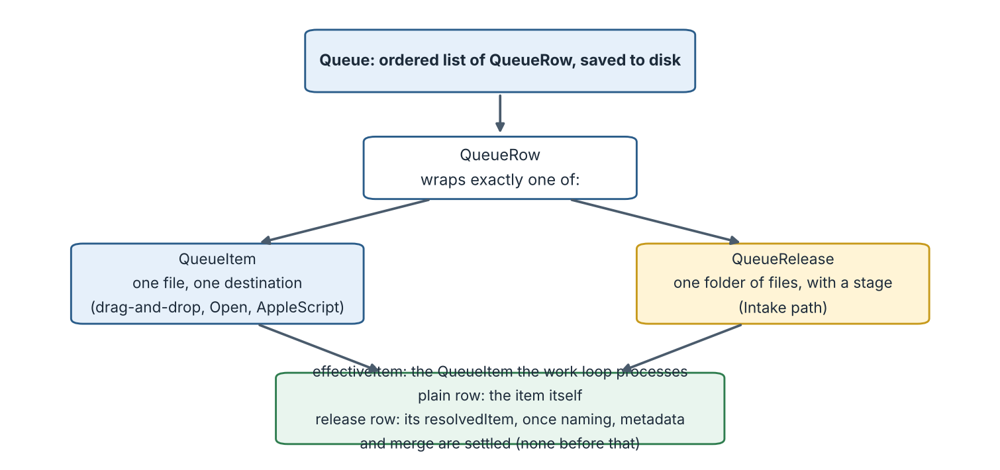
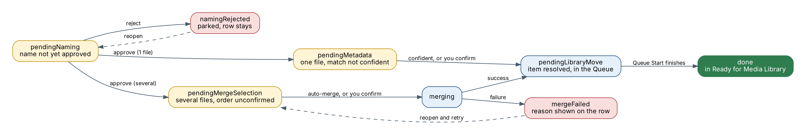
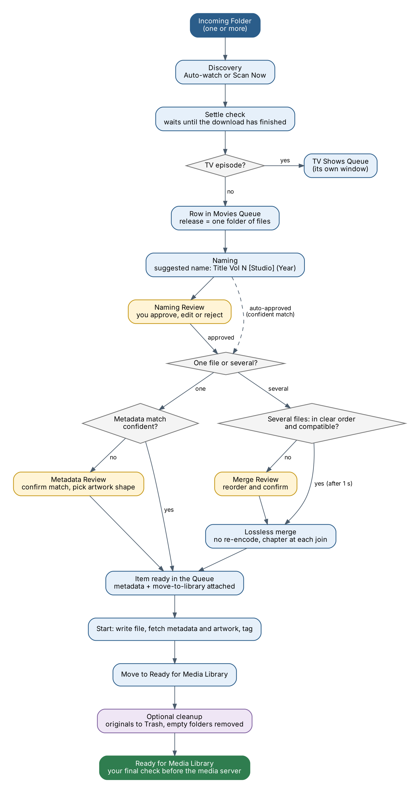

# About this guide

This guide describes every window, menu and setting of Media Metadata Manager (M3) and walks through the common tasks. If you only want to get going, read the **Getting Started Guide** first and come back here for detail.

**Conventions.** Menu paths are written *Menu → Item*. Buttons and settings are shown in **bold**. File and folder names are shown in `code style`. Notes marked *Tip* are optional shortcuts; notes marked *Important* describe behavior that can affect your files.

**Scope.** M3 is a personal fork of the open-source Subler app. Everything Subler does — muxing and tagging MP4, M4V and MOV files, importing tracks from MKV and raw formats, chapters, subtitles, OCR of image subtitles — still works. This guide concentrates on what M3 adds: extra metadata sources, the Queue-based Intake workflow, lossless merging, naming rules, library scanning and the cleanup options.

# 1. Concepts in one page

**Incoming Folder.** A folder where downloads arrive. M3 can watch one or several of them.

**Ready for Media Library.** The staging folder where finished files and folders are placed. It is your last human checkpoint before the files reach a media server. M3 never writes into your final library itself.

**Queue.** An ordered list of jobs. There are two: the **Movies Queue** and the **TV Shows Queue**. Jobs run in the order shown, one at a time.

**Row.** One line in a Queue. A row is either a plain **item** (a single file you added by hand) or a **release** (a folder of files discovered by Intake that still needs naming, a metadata decision, or a merge).

**Release.** A folder that holds one title, either as one file or as several parts. A release moves through stages: waiting for naming, waiting for a metadata decision or merge order, merging, ready, done. A release stays the same row for its whole life.

**Review sheet.** A small panel that slides out of the Queue window when M3 needs a decision from you: *Naming Review*, *Metadata Review* or *Merge Review*. You open one by double-clicking a row or choosing **Edit**.

**Provider.** An online source of metadata and artwork, such as TheMovieDB, TheTVDB, Apple TV or the iTunes Store. **Custom sources** are providers you define yourself from a web API. **Plugins** are compiled providers added as bundles.

**Set.** A saved group of metadata fields that you can apply to a file in one step, for example a fixed rating or content advisory.

**Naming rule.** A template that builds a file name from the file's tagged metadata, for example `Title [Studio] (Year)`. Rules can be conditional.

# 2. Installing and starting M3

M3 is built from source in Xcode (see the project README for build instructions). The built app is a normal Mac application; copy it to your Applications folder.

On first launch you will see the **Welcome window** with three actions:

- **Tag One File** — open a single file to search for and apply its metadata.
- **Merge and Tag Files** — combine several files into one in the Queue, then tag the result.
- **Scan Library for Missing Metadata** — look through a folder for files that still need tagging.

Untick **Show this window at launch** to stop seeing it. You can choose what M3 does at launch under **Preferences → General → At Launch**: show the open panel, show the main window, or show the Queue.

*Important.* M3 never takes updates from the original Subler. Once this project publishes its own update feed, **Check for Updates…** and the automatic daily check use that feed only. Updating replaces the application only: your preferences, folders, keys and installed plugins stay where they are.

# 3. The windows

## 3.1 The Editor (single-file window)

Opening a file with **File → Open…**, from the Welcome window, or by double-clicking a Queue row's **Edit** button shows the editor. It lists the file's tracks, its chapters and its tags, and lets you change any of them.

**Toolbar.** The default toolbar contains:

| Button | Action |
|---|---|
| **Open** | Open another file. |
| **Save** | Write your changes to the file. |
| **Save & Close** | Save and close the window in one step. |
| **Search Metadata** | Search the enabled providers and apply a result. |
| **Send to Queue** | Add the open document to the Queue instead of saving directly. |
| **Queue** | Show the Queue window. |
| **Import / Delete / Action** | Add a track from another file, remove the selected track, and a menu of track tasks (insert chapters at a fixed interval, organize alternate groups, clear or prettify track names, fix audio fallbacks, offset). |
| **Settings** | Open Preferences. |

You can change which buttons are shown, and whether they show icons, text or both, with **View → Customize Toolbar…** or by right-clicking the toolbar. *Tip:* if you customized the toolbar before an update, new buttons such as **Save & Close** appear in the Customize Toolbar sheet and can be dragged in.

**Undo and redo.** Every edit — tags, artwork, tracks, chapters — can be undone and redone with **Edit → Undo / Redo**. The window's edited dot clears when you undo everything or save.

### Searching for metadata

1. Click **Search Metadata**. The title field is pre-filled from the file name, with release codes and quality tags removed.
2. Results appear in a list. Select one to see its full metadata and artwork on the right. The first result is selected for you.
3. Choose the artwork you want. **Select All** adds every available image; **Load more artwork…** fetches additional images.
4. Click **Add**. Fields that changed are highlighted in the editor, with a tooltip, until you edit them by hand.

*Important.* If you save a movie that has no title tagged, M3 leaves its file name and folder alone. Run a metadata search first if you want the file renamed from its tags.

## 3.2 The Queue windows

Choose **Window → Show Movies Queue** or **Window → Show TV Shows Queue**. The two windows are identical in behavior; each keeps its own list and its own saved state across launches. The Dock badge shows the combined number of waiting items.

**Toolbar.** The default order, from the left, is **Add Item**, **Merge**, **Start / Stop**, flexible space, **Settings**.

| Button | Action |
|---|---|
| **Add Item** | Add files or folders to the Queue by hand. Files added this way become plain items. |
| **Merge** | Enabled when two or more not-yet-processed items are selected. Opens the Merge Review sheet, then asks where to save the merged file. |
| **Start / Stop** | Run or pause the Queue. |
| **Settings** | Show or hide the Queue Options panel (see 3.3). |

The toolbar's display mode (icon, icon and text, or text only) also controls the **Info** and **Edit** buttons on each row and the progress display at the bottom of the window: with text shown, a percentage; with icons only, a progress bar.

**Rows.** Each row shows a status icon and the name. On the right are two buttons:

- **Info** shows the item's source, destination and the actions that will run.
- **Edit** opens the editor for that file, or the right review sheet for a release that is waiting for you.

Closing an editor window does not remove its row.

**Row states for a release.**

| State | Meaning | What to do |
|---|---|---|
| Waiting for naming | The folder was found; its name is not yet approved. | Double-click to open Naming Review. |
| Naming rejected | You rejected the suggested name. The row stays so nothing is lost. | Double-click to review again. |
| Waiting for metadata review | One file; the online match was not confident enough. | Double-click to open Metadata Review. |
| Waiting for merge order | Several files; the order is not yet confirmed. | Double-click to open Merge Review. |
| Merging | The parts are being joined. | Wait; progress is shown on the row. |
| Merge failed | The parts could not be joined. The reason is shown in plain language. | Double-click, adjust the selection, retry. |
| Ready | A single file is ready to be written. | Click **Start**. |
| Done | The folder has been moved to Ready for Media Library. | Remove it with **Remove completed items**. |

**Context menu.** Right-click a row for **Reveal in Finder**, **Edit…**, **Remove from queue** and **Remove completed items**. You can also drag rows to change their order, and drop files or folders from Finder into the window.

## 3.3 Queue Options

The **Settings** button reveals the options applied to items you add by hand and to released items as they are processed:

- **Global options:** *Auto-Start the queue*; *Show Notification When Done* (macOS asks permission the first time).
- **Location** and **File Type** (`mp4` or `m4v`) for the output.
- **Apply Set**, **Fetch Metadata** and the provider language for Movies and TV Shows, **Artwork** shape (Portrait, Landscape, Square or Rectangle), and **Set output filename**.
- **Track tidy-ups:** *Clear existing metadata*, *Rename chapter titles*, *Organize groups*, *Prettify audio track names*, *Fix audio fallbacks*, *Clear track names*, *Load external subtitles*, *Complete tracks language*, *Enable audio / subtitle track with language*.
- **Optimize**, **Send to AppleTV/iTunes** and the **color space** options.

## 3.4 Review sheets

**Naming Review.** Shows the original folder name, how many files it holds, and an editable suggested name. A local guess appears immediately; a background search of your enabled providers refines it unless you have started typing. Buttons:

- **Approve** renames the folder to the approved name.
- **Reject** parks the row without touching any file.
- **Search All Providers…** runs a second pass that shows one result from every enabled provider, so you can pick the correct one.

If **Automatically approve high-confidence naming matches** is on and the online title matches the file name exactly (and the years agree when both are known), the sheet approves itself after about a second. Typing in the field or clicking a button cancels that.

**Metadata Review.** Appears for a single-file release whose automatic match was not confident. It shows the match found and an artwork preview, with a **Portrait / Landscape** control that applies only to this release.

**Merge Review.** Lists the parts. Drag them into play order. The sheet starts in the order implied by the files' own numbers (`01`, `02`, `Part 1`, `e1`…). Confirming starts the merge.

## 3.5 Library scan window

Choose **Scan Library for Missing Metadata** on the Welcome window. Pick a folder and click **Scan**. M3 walks the folder for finished `.mp4`, `.m4v` and `.mov` files and lists those missing a Title, Release Date, Rating or Studio. Double-click a file to open it in the editor. The scan only reports; it never changes a file.

## 3.6 Message log

**Window → Show Message Log** shows what M3 has been doing. It is the first place to look, and the thing to attach, when reporting a problem.

# 4. Preferences

Open **Media Metadata Manager → Preferences…** (or the **Settings** toolbar button). Tabs:

## General

At-launch behavior, whether the window remembers its size, the default artwork position (Portrait or Landscape), chapter preview image position, log format, the ratings region to show (USA ratings are always shown), and privacy actions: *Clear recent searches* and *Delete cached metadata*.

## Metadata

Choose which tags are shown for Movies and TV Shows and in what order. **Fill Series Description for sequels/parts** copies the series description when a title ends in a number or in "Part…".

## Sets

Create and edit Sets: named collections of tag values that can be applied to a file with one click, or automatically by the Queue.

## Filename

Naming rules decide the output file name. There is a rule list for **Movies** and one for **TV Shows**. Each rule is a template built from tokens (title, studio, year and so on) with optional conditions (**If / And / Or** a field has a value). The first matching rule wins; the **Default** rule is used when none matches. A rule can be switched off with its checkbox. Two extra options live here:

- **Keep the containing folder named to match** — after saving, rename a folder that holds only this one movie to the same name as the file.
- **Organize into Show/Season folders (Apple TV style)** — create `Show/Season NN` folders for TV episodes.

A movie with no title tagged is never renamed, whatever the rules say.

## OCR

Download or remove the language data used to convert image-based subtitles to text.

## Advanced

Audio conversion choices (AC-3, DTS, downmix, dynamic range control, bitrate), *Force QuickTime Compatibility*, *Infer media characteristics*, alternate-group organization and HEVC options.

## Sources

Three sub-tabs:

- **Providers** — tick the built-in providers you want for Movies and for TV Shows. Installed plugins appear in the same list, each with a **Configure…** button where the plugin needs settings. **Complete Content Search** asks TheMovieDB to include its complete result set.
- **Custom Sources** — define your own providers (see section 7).
- **Media Intake** — the Intake workflow settings (see section 5).

## Support

Links to sponsor Media Metadata Manager through GitHub Sponsors and to the original Subler project, whose author Damiano Galassi created the app M3 is built on. The same two links are in a small dialog under **Media Metadata Manager → Support…**. Nothing pops up on its own, and the buttons only open a web page in your browser.

# 5. Media Intake in detail

## 5.1 Settings reference

All of these are in **Preferences → Sources → Media Intake**. Hover over any option to see its tooltip.

| Setting | Default | What it does |
|---|---|---|
| **Incoming Folders** (+ / −, **Choose…**) | none | The folders M3 looks in. Loose files are wrapped in a folder of their own; folders holding media (up to three levels down) become releases. |
| **Scan Now** | — | Looks in the Incoming Folders immediately and adds what it finds, even when watching is off, without waiting for files to settle. TV episodes go to the TV Shows Queue. |
| **Automatically watch these folders for new files** | off | Watches the folders and also re-checks every 20 seconds. A new item is added once its files have stopped changing for about 10 seconds. |
| **Automatically approve high-confidence naming matches** | off | Approves the suggested name without a click when the online title matches exactly. |
| **Rename the source folder after merging, when a correct name is found** | off | After a manual Queue merge, renames the download folder to a correct release name found nearby (a cover image, the folder name, or a well-named video). Never overwrites an existing folder. |
| **Automatically merge multi-file releases with a clear sequence** | off | When every part carries a sequence number and the parts are compatible, merges after about a second instead of stopping at Merge Review. Opening the row in that second cancels it. |
| **Remove empty folders automatically** | off | After each Queue run and each editor save, moves empty folders inside the Incoming and Ready folders to the Trash and logs them. Folders touched in the last two minutes are left alone. The same cleanup can be run by hand with **Window → Clean Up Empty Folders…**. |
| **Clean up processed files** | off | After a release is moved into Ready for Media Library, moves the original files it was made from (the parts that were merged, or the unconverted source of a single file) to the Trash and logs them. The finished file is never touched. |
| **Ready for Media Library** | none | The staging folder. Releases are moved here as the last step. |
| **Automatically Add to iTunes/TV Folders** (+ / −) | the Music/TV app's folder | Files saved straight into one of these are left alone instead of being wrapped in a folder, because the Music or TV app organizes them itself. |

## 5.2 What happens, step by step

1. **Discovery.** M3 finds media files in the Incoming Folders. It ignores hidden files, packages, symbolic links, the Ready folder, and folders that still contain unfinished downloads (`.part`, `.crdownload` and similar). Anything it has already taken in, or that is already in a Queue, is skipped. A path is forgotten once the file is gone, so putting a file with the same name back later is treated as new.
2. **TV or movie.** A name with a season and episode marker (for example `S02E05` or `2x05`) goes to the **TV Shows Queue**; everything else goes to the **Movies Queue**.
3. **Naming.** M3 proposes `Title Vol N [Studio] (Year)`. It understands uploader-stamped names such as `2026_Uploader_Title_Studio_720p` and `03.10.2026_Uploader_Title_Studio_720p`, and scene names such as `Title.2023.1080p.WEB-DL.x264-GROUP`. You approve, edit or reject, or it is approved automatically when you have chosen that option.
4. **Metadata or merge.** One file: the online match is checked. Several files: the parts are checked for compatibility and ordered.
5. **Ready.** The release becomes a normal Queue item with a metadata step and a move-to-library step attached.
6. **Start.** The Queue writes the file, searches the provider you chose, applies artwork and tags, and then moves the whole release folder into **Ready for Media Library**. If a folder with that name already exists there, the new one is called `name 2`, `name 3` and so on; nothing is overwritten.
7. **Cleanup** (if enabled), then your final check in the Ready folder.

## 5.3 Lossless merge

Joining parts does not re-encode anything. M3 splices the compressed video and audio samples one after another and adds a chapter at each join, named after the source file.

Parts are merged only when they match: the same number of video, audio and subtitle tracks, the same codecs and time scales, and the same picture size. If they do not match, the merge is refused and the row explains which file differs and how. Nothing is partly merged. Incompatible parts need to be converted first.

You can also merge by hand: select two or more items in the Queue and click **Merge**, or choose several files in **File → Open…** and answer **Merge Into One File…**. The merged file is written next to the parts by default.

## 5.4 Safety guarantees

- Intake only moves files and folders; it never deletes. Removal happens only through the two cleanup options, and only to the **Trash**.
- Cleanup actions are written to `Removed Empty Folders.txt` and `Cleaned Up Processed Files.txt` in `~/Library/Application Support/M3/`.
- A failed move (disk full, drive disconnected) cleans up after itself and offers another location.
- Parts are kept after a merge unless you turn on **Clean up processed files**, so you can check the result before the originals are gone.

# 6. Common tasks

**Tag one file.** Welcome window → **Tag One File** → **Search Metadata** → choose a result → **Save & Close**.

**Process a download automatically.** Add the Incoming Folder, tick **Automatically watch**, optionally tick the auto-approve and auto-merge options. New downloads appear in the Queue; open any row that shows a waiting state; click **Start**.

**Merge parts by hand.** Add the parts to the Movies Queue, select them, click **Merge**, drag them into order, confirm, and choose where to save.

**Handle TV episodes.** Episodes found by Intake go to the TV Shows Queue. Turn on **Organize into Show/Season folders** under Preferences → Filename to have them filed as `Show/Season 01/…`. Files you drop into a Queue by hand stay in the Queue where you dropped them.

**Find files that need tagging.** Welcome window → **Scan Library for Missing Metadata**.

**Undo a mistake.** In the editor use **Edit → Undo**. For files moved by cleanup, open the Trash and choose **Put Back**.

**Start over with a stuck download.** Remove its row, make sure the file is in the Incoming Folder, and click **Scan Now**.

# 7. Metadata sources

**Built-in providers.** TheMovieDB, TheTVDB, Apple TV and the iTunes Store. Each can be switched on or off separately for movies and TV in Preferences → Sources → Providers. The Queue uses the provider chosen in Queue Options for its automatic lookup; the naming window consults every enabled provider in turn.

**Custom Sources.** In Preferences → Sources → Custom Sources, click **+** to define a source from a web API: a base address, a search address, a detail address, and a table that maps the API's fields to M3's tags. Each source opens in its own window. Requests time out rather than hang, and request and response bodies are written to the message log to help you debug a mapping.

**Plugins.** A plugin is a compiled bundle placed in `~/Library/Application Support/M3/Plugins/` and loaded at launch. Plugins are never part of the app itself. To add one, drag its `.bundle` onto the Custom Sources list (or place it in that folder) and restart M3; plugins are loaded once, at launch. After the restart the plugin appears in Preferences → Sources → Providers with its own checkbox, switched on by default, and an enabled plugin is used in searches like any built-in provider. A plugin that needs settings (a server address, a key) declares them itself, and the **Configure…** button next to it opens a form built from that declaration. M3 contains no built-in knowledge of any particular plugin. Your plugin settings are stored in your own preferences, not in the app, so updating M3 never removes them.

# 8. Files and locations

| What | Where |
|---|---|
| Preferences | the app's standard macOS preferences |
| Queue state | `~/Library/Application Support/M3/` (movie queue and TV queue are separate files) |
| Sets, Queue presets, custom-source definitions | `~/Library/Application Support/M3/` |
| Plugins | `~/Library/Application Support/M3/Plugins/` |
| Cleanup logs | `~/Library/Application Support/M3/Removed Empty Folders.txt` and `Cleaned Up Processed Files.txt` |
| Message log | **Window → Show Message Log** |

M3 renamed its data folder from `Subler` to `M3`; an older folder is moved across automatically on first launch.

# 9. Troubleshooting

| Problem | Cause and fix |
|---|---|
| A download is not picked up | It is still growing (wait or click **Scan Now**); its folder holds a `.part` file; the folder is not listed under Incoming Folders; or its path is inside the Ready folder. |
| A new file with an old name is ignored | Update to a build that forgets finished paths. In older builds the name had been remembered. |
| The folder name came out as `[] ()` | The file was saved with no title tagged. Current builds leave such files alone; run **Search Metadata** before saving. |
| Naming Review finds no match | The title may include a performer or subtitle the provider does not use. Edit the name, or use **Search All Providers…**. |
| Merge failed | Open the row and read the reason. Parts must share codecs, track layout and picture size. |
| **Merge** is greyed out | Select two or more items that have not been processed yet. |
| The toolbar is missing a button | Right-click the toolbar → **Customize Toolbar…** and drag it in. |
| Nothing happens on **Start** | The Queue is empty of items that are *Ready*. Releases waiting for naming, a metadata decision or a merge order are not run until you finish those steps. |

# 10. Glossary

**Alternate group** — tracks that are alternatives of one another, such as audio languages. **Artwork position** — Portrait (tall poster) or Landscape (wide), used when choosing among available images. **Chapter** — a named marker in the timeline. **Mux** — to write tracks into one file container. **Provider language** — the language requested from an online source. **Release** — one title's folder of files. **Remux / lossless** — repackaging without re-encoding, so quality is unchanged.

*Media Metadata Manager is based on Subler by Damiano Galassi and contributors and on MP42Foundation. TMDb data is used under its terms; this product is not endorsed or certified by TMDb. See CREDITS.md.*
